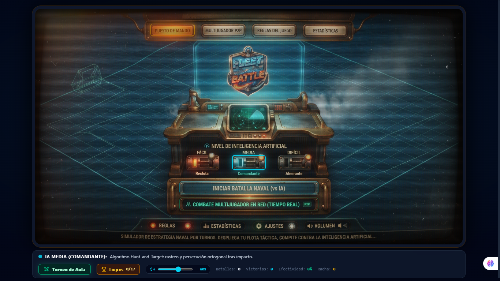
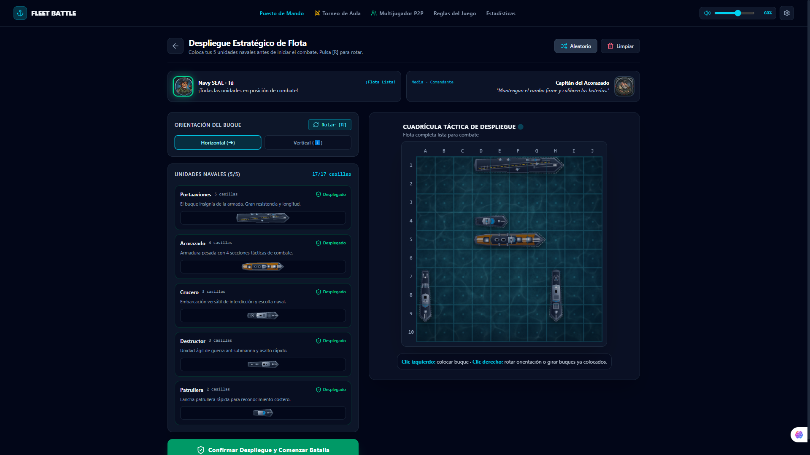
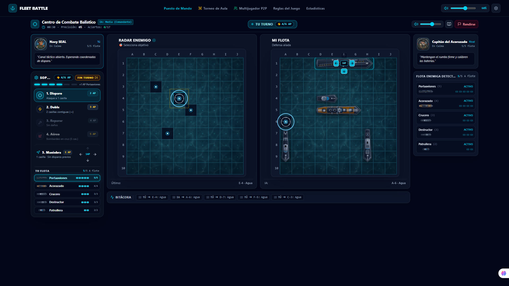
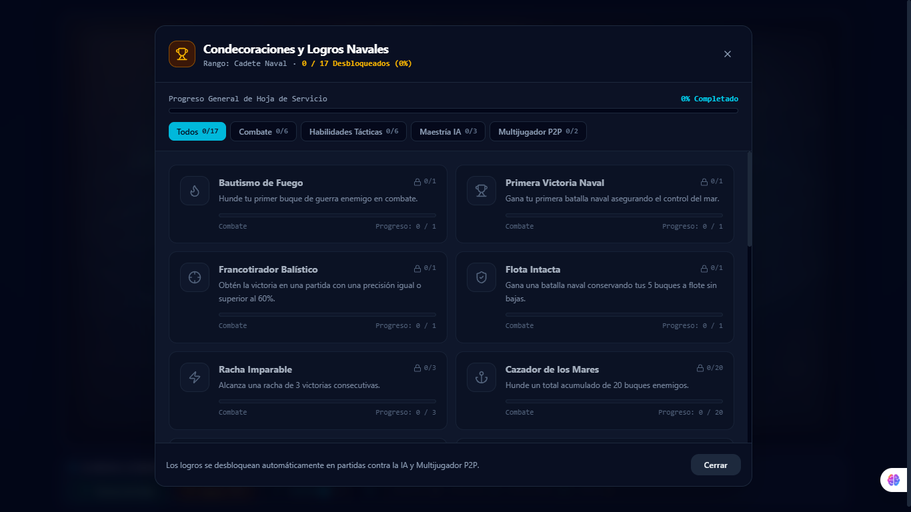
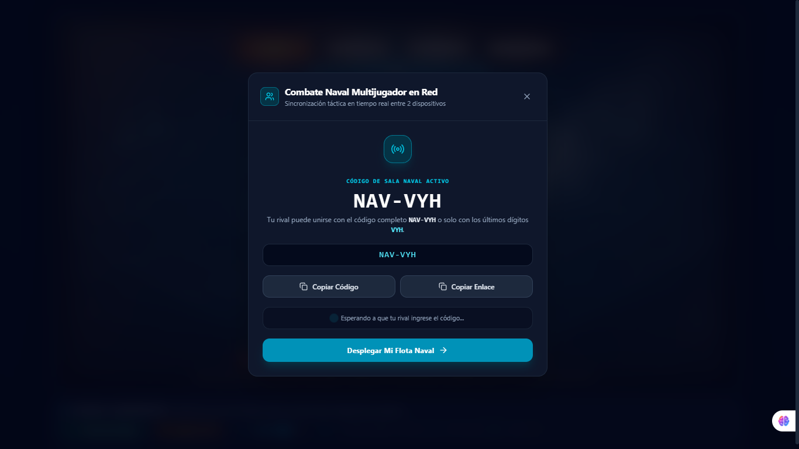
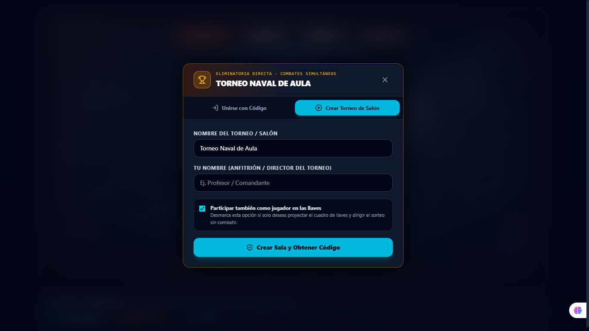

# ⚓ Fleet Battle — Batalla Naval



**Fleet Battle — Batalla Naval** es un juego de estrategia naval táctico por turnos desarrollado con **React 19, TypeScript, Vite, Tailwind CSS v4 y Express**. Evoluciona el clásico *Battleship* con un centro de operaciones estilo terminal CRT retro, inteligencia artificial algorítmica en tres niveles, un sistema táctico de **Puntos de Acción (AP)** y habilidades por clase de buque, multijugador en red local/remota con verificación anti-trampas **SHA-256** y un modo **Torneo de Aula** con llaves eliminatorias en vivo.

---

## ✨ Características Principales

* **Centro de Operaciones CRT Interactivo:** Menú principal diseñado sobre una consola retro con botones calibrados, selector de dificultad con palancas iluminadas, radar sonar interactivo y control de volumen/efectos.
* **Inteligencia Artificial en 3 Niveles ([`src/ai/brain.ts`](./src/ai/brain.ts)):**
  * **Fácil (Recluta):** Ataques pseudoaleatorios sin memoria táctica post-impacto.
  * **Media (Comandante):** Algoritmo *Hunt-and-Target* con rastreo y persecución ortogonal tras cada impacto.
  * **Difícil (Almirante):** Matriz bayesiana de densidad probabilística continua con filtrado en damero según las longitudes de flota restantes.
* **Combate Táctico con Puntos de Acción (AP) y Habilidades:**
  * Gestiona tus AP por turno para combinar disparos estándar, ataques dobles, reparaciones de casco, escaneos de **Sonar**, **Ataques Aéreos** en cruz, ráfagas en línea y **Maniobras evasivas** para reposicionar buques intactos.
  * Flota vectorial en SVG de 5 unidades navales: *Portaaviones (5)*, *Acorazado (4)*, *Crucero (3)*, *Destructor (3)* y *Patrullero (2)*.
* **Multijugador en Red (`NAV-XXX`) con Anti-Trampas SHA-256:**
  * Crea o únete a salas mediante código o enlace directo.
  * Al confirmar el despliegue, el cliente genera un hash determinista **SHA-256** de la flota (`computeFleetHash` en [`src/services/multiplayer.ts`](./src/services/multiplayer.ts)) como prueba criptográfica de integridad.
* **Torneo de Aula (`TOR-XXX`):**
  * Lobby para múltiples participantes, sorteo automático de llaves eliminatorias con gestión de *byes*, creación simultánea de salas de combate, estado en vivo y vista de espectador.
* **Progresión, Audio y Cinemáticas:**
  * Registro de estadísticas, historial de partidas y **17 condecoraciones/logros navales** desbloqueables persistidos en `localStorage`.
  * Banda sonora ambiental, efectos de sonar/explosiones e intro/outro cinemáticos.

---

## 📸 Capturas de Pantalla

| Puesto de Mando (Menú CRT) | Despliegue Estratégico de Flota |
| :---: | :---: |
|  |  |

| Combate Táctico (AP, Radar y Bitácora) | Logros y Condecoraciones Navales |
| :---: | :---: |
|  |  |

| Sala Multijugador en Red (`NAV-XXX`) | Torneo Naval de Aula (`TOR-XXX`) |
| :---: | :---: |
|  |  |

---

## 🛠️ Tecnologías Utilizadas

* **Frontend:** React 19, TypeScript, Vite 8, Tailwind CSS v4, Framer Motion (`motion`), Lucide React.
* **Backend:** Node.js + Express (`server.ts`) con middleware de Vite en desarrollo y soporte para salas multijugador y torneos.
* **Testing y Calidad:** Vitest (`vitest run`) y verificación estática de tipos (`tsc --noEmit`).

---

## 📂 Estructura del Proyecto

```text
fleet-battle-battleship/
├── docs/screenshots/       # Capturas de la aplicación para documentación
├── public/assets/aistudio/ # Recursos gráficos, música MP3 y cinemáticas MP4
├── src/
│   ├── ai/brain.ts         # Motor de decisión de IA (Fácil, Media, Difícil)
│   ├── components/         # Vistas de consola, tableros, buques SVG y modales
│   ├── engine/             # Lógica de tablero, AP, maniobras y resolución de combate
│   ├── hooks/              # Hook principal de estado del juego (useGameEngine)
│   ├── services/           # Audio, almacenamiento local y cliente multijugador/torneo
│   ├── types/              # Definiciones TypeScript compartidas
│   └── utils/              # Coordenadas y configuración clásica de flota
├── tests/                  # Suites unitarias (IA, tablero, combate y multijugador)
├── server.ts               # Servidor Express + API REST de salas y torneos
└── package.json
```

---

## 🚀 Instalación y Ejecución Local

Los modos **vs. IA**, **Multijugador en Red** y **Torneo de Aula** corren completos ejecutando el servidor local integrado (`server.ts`):

1. **Clonar el repositorio:**
   ```bash
   git clone https://github.com/popcorner893/fleet-battle-battleship.git
   cd fleet-battle-battleship
   ```

2. **Instalar dependencias:**
   ```bash
   npm install
   ```

3. **Iniciar el servidor en modo desarrollo:**
   ```bash
   npm run dev
   ```
   Abre tu navegador en `http://localhost:3000`.

### Scripts Disponibles

| Comando | Descripción |
| :--- | :--- |
| `npm run dev` | Inicia el servidor Express + Vite en el puerto `3000` (o el configurado en `PORT`). |
| `npm test` | Ejecuta las 4 suites de pruebas unitarias con Vitest (`tests/`). |
| `npm run lint` | Verifica todos los tipos de TypeScript (`tsc --noEmit`). |
| `npm run build` | Genera el paquete de producción en `dist/`. |
| `npm start` | Ejecuta `server.ts` (en producción con `NODE_ENV=production` sirve `dist/`). |

> **Nota sobre multijugador local:** Para probar **Multijugador** o **Torneo de Aula** desde otra pestaña o dispositivo en la misma red local, abre la misma URL/IP del servidor en otro navegador y usa el código de sala (`NAV-XXX`) o torneo (`TOR-XXX`).
